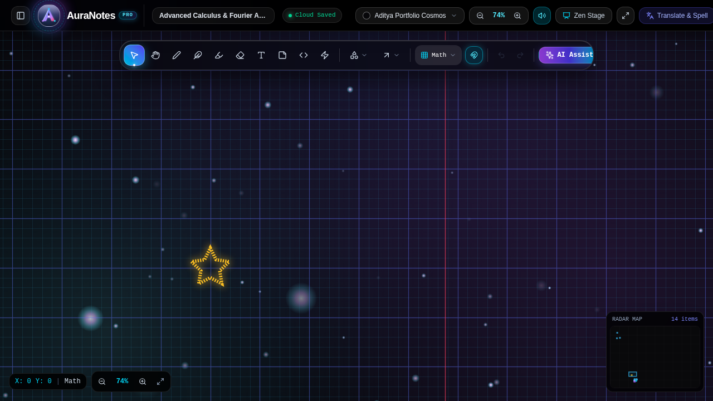

# Nexora Notes

> **"Your thoughts, without limits."**  
> Production-grade, AI-assisted infinite canvas and note-taking workspace with an AMOLED dark-mode engineering math grid, rich shape manipulation, real-time autosave, and enterprise-grade security.

Inspired by the spatial freedom of Miro, the structured engineering math graph paper of Kodenest & OneNote, and the minimal elegance of modern workspaces.



---

## 🌟 Key Features (100+ Backlog Highlights)

### 📐 1. Infinite AMOLED Canvas & Math-Paper Grid
- **Infinite Math-Paper Grid:** 5mm sub-grid squares (`24px`) with 25mm major accent squares (`120px`), coordinate origin axes at `(0,0)`, and live coordinate HUD.
- **Multiple Grid Presets:** Cycle between `Math Graph Paper`, `Bullet Dot Grid`, `Ruled Notebook Lines`, and `Pure Minimal AMOLED Black`.
- **60 FPS Fluid Navigation:** Smooth panning via Spacebar + Drag, Middle-Click Drag, or Hand tool (`H`).
- **Pinch-to-Zoom:** Zoom from 10% to 500% centered at cursor with quick 100% reset (`0`).
- **Magnetic Snapping:** Snap-to-grid toggle with precision alignment for shapes, connectors, and text.
- **Radar Minimap:** Live interactive viewport radar in bottom-right with 1-click viewport jumping.

### 🎨 2. Rich Editing & Drawing Tools
- **Rich Text Engine:** Inline editable text with font styles (`Plus Jakarta Sans`, `JetBrains Mono`, `Caveat Handwriting`), sizes (14px–44px), bold, italic, and underline.
- **Geometric Shape Library:** Rectangles, rounded cards, circles/ellipses, straight lines, and directional arrows with customizable arrowhead styles.
- **Freehand Pen & Highlighter:** Pressure-simulated smooth vector drawing and translucent highlighter with eraser tool (`E`).
- **Sticky Notes:** Color-themed sticky cards (Amber, Emerald, Cyan, Purple, Rose, Slate).
- **Code Block Snippets:** Syntax-formatted code containers with language badges and title bars.
- **Laser Pointer:** Live presentation laser spark that dissolves smoothly over 800ms.
- **Floating Property Inspector:** Contextual floating bar for stroke color, fill tint, stroke width (1–8px), stroke dash styles, layers, and duplicate (`Ctrl+D`).

### ⚡ 3. Persistence, Autosave & Portability
- **Debounced Cloud Autosave:** Auto-saves canvas state 1.2s after last edit with real-time sync status (`All synced`, `Saving...`, `Unsaved changes`).
- **History Engine:** Multi-level Undo (`Ctrl+Z`) and Redo (`Ctrl+Y` / `Ctrl+Shift+Z`) with immutable state snapshots.
- **Export Formats:**
  - **PNG:** Standard 1x, Retina 2x, or Ultra 4K resolution.
  - **SVG:** Clean, infinitely scalable vector XML.
  - **PDF:** Print-ready centered layout.
  - **JSON Archive:** Complete note state backup & validated JSON import.
- **Direct Source Code Download:** Export modal allows 1-click download of the complete clean project ZIP archive.

### 🧠 4. Nexora AI Brain (Powered by Google Gemini 3.8 Flash)
- **Math & Derivation Solver:** Step-by-step calculus derivation, algebra solving, and circuit proofs with clean LaTeX-style output.
- **Brainstorming Engine:** Generates high-impact ideas directly convertable to canvas sticky notes.
- **Mind Map Generator:** Hierarchical concept breakdown auto-converted into connected nodes and directional arrows on canvas.
- **Cornell Note Summarizer:** Automatically structures messy thoughts into Summary, Key Concepts, and Action Items.

### 🔒 5. Authentication, Two-Factor OTP & Security
- **Account Management:** User profile editing, email change, and password reset.
- **Phone OTP Verification:** Two-Factor authentication with 6-digit verification code simulation, rate limiting, and verification state.
- **Security Audit Trail:** Complete log of recent authentication events with timestamps, device information, and IP addresses.
- **PostgreSQL Row Level Security (RLS):** Production-ready SQL schema with strict user-isolation policies (`auth.uid() = user_id`).

---

## 🚀 Quick Start Guide

### 1. Installation
```bash
git clone https://github.com/your-username/nexora-notes.git
cd nexora-notes
npm install
```

### 2. Environment Variables
Copy `.env.example` to `.env`:
```bash
cp .env.example .env
```
Ensure `GEMINI_API_KEY` is provided if using live AI capabilities.

### 3. Run Development Server
```bash
npm run dev
```
The application will be live at `http://localhost:3000`.

### 4. Run Unit Tests & Lint
```bash
npm test
npm run lint
```

### 5. Production Build
```bash
npm run build
npm start
```

---

## ⌨️ Essential Keyboard Shortcuts

| Shortcut | Action |
| :--- | :--- |
| `Space + Drag` / `Middle Click` | Pan infinite canvas freely |
| `Wheel / Pinch` | Zoom in / Zoom out (10% to 500%) |
| `Ctrl / Cmd + Z` | Undo last change |
| `Ctrl / Cmd + Y` | Redo action |
| `Ctrl / Cmd + S` | Save note (prevents browser save) |
| `Ctrl / Cmd + D` | Duplicate selected element(s) |
| `Ctrl / Cmd + A` | Select all elements |
| `Delete` / `Backspace` | Delete selected element(s) |
| `V` | Select tool |
| `H` | Hand / Pan tool |
| `P` | Pen / Pencil tool |
| `E` | Eraser tool |
| `T` | Text tool |
| `S` | Sticky note card |
| `R` | Rectangle card |
| `C` | Circle shape |
| `A` | Directional Arrow |
| `L` | Straight Line |
| `X` | Code snippet block |
| `Z` | Laser presentation pointer |
| `Escape` | Clear selection / Close modals |

---

## 📦 Project Architecture
```
/
├── server.ts                  # Full-stack Express + Vite server & Gemini AI API
├── src/
│   ├── App.tsx                # Main workspace orchestrator
│   ├── types/index.ts         # TypeScript data contracts & models
│   ├── utils/
│   │   ├── canvasMath.ts      # Pure coordinate transforms, grid snapping, fuzzy search
│   │   ├── canvasMath.test.ts # Automated unit test suite (node:test)
│   │   ├── history.ts         # Immutable undo/redo history manager
│   │   └── exporter.ts        # PNG, SVG, PDF, and JSON export engine
│   └── components/
│       ├── Canvas/            # Infinite canvas, floating toolbar, style picker, minimap
│       ├── Header/            # Top navigation bar conforming to Top Bar Contract
│       ├── Sidebar/           # Notes library with search, tags, pin, and trash bin
│       ├── AI/                # Nexora AI Brain modal
│       ├── Export/            # High-res export and source code download modal
│       ├── Auth/              # Security Center & Phone OTP verification
│       ├── Templates/         # Starter blueprint templates (Calculus, Architecture, Miro Sprint)
│       └── Shortcuts/         # Keyboard shortcuts directory modal
├── supabase/migrations/       # PostgreSQL RLS migrations & indexes
├── .github/workflows/ci.yml   # GitHub Actions continuous integration
└── docs/                      # Deployment, security, and architecture documentation
```

---

## 📄 License
Apache-2.0
